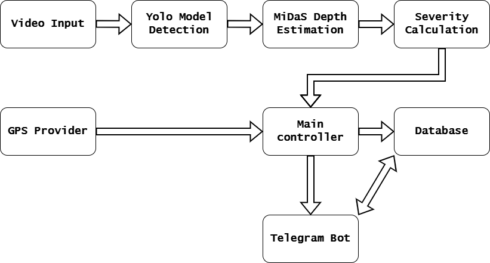
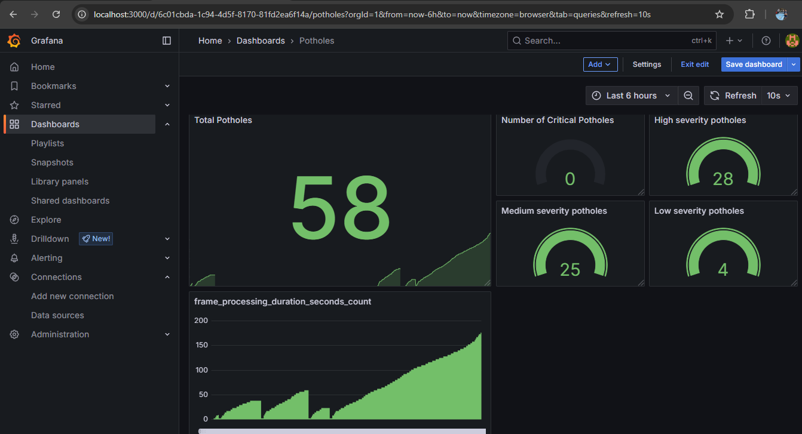

# Pothole Detection System

A Python computer-vision project that processes a video or camera feed, detects potholes with YOLO, estimates relative depth with MiDaS, and stores detections in SQLite.

This repository is a student-maintained adaptation of an existing project. See [Upstream project and license](#upstream-project-and-license) for attribution.

For an interview-friendly explanation of the project, see [INTERVIEW_GUIDE.md](INTERVIEW_GUIDE.md).

## Features

- Pothole detection and annotated video output
- Severity labels based on estimated area and depth
- Simulated or serial-device GPS input
- SQLite storage, duplicate-location checks, and offline log retry
- Optional Prometheus metrics and Grafana dashboard

## Screenshots

**System architecture**



**Monitoring dashboard**



## Important limitations

- MiDaS estimates relative depth from images. The current conversion is a heuristic, not calibrated measurement of real-world pothole depth.
- Simulated GPS chooses random coordinates in Serbia and uses the online Nominatim geocoding service. It is for demonstration, not navigation or reporting real pothole locations.
- The current application initializes all configured services at startup. Add any required credentials to your local `.env` file before running it.
- The full application has not been tested on every camera, operating system, or GPU. Model loading and inference may require additional downloads and substantial disk space.

## Requirements

- Python 3.10 or newer
- Internet access for model downloads and simulated GPS geocoding
- A camera for live input, or the included sample video at `assets/videos/sample_video.mp4`

PyTorch installation can differ depending on whether you use a CPU or a CUDA-compatible GPU. If the default installation below does not match your hardware, follow the official [PyTorch installation selector](https://pytorch.org/get-started/locally/) and then install the remaining packages from `requirements.txt`.

## Run locally on Windows

Open PowerShell in the project folder:

```powershell
py -m venv .venv
.\.venv\Scripts\Activate.ps1
python -m pip install --upgrade pip
python -m pip install -r requirements.txt
```

The default run does not require a `.env` file or external credentials. To change settings, copy `.env.example` to `.env` and edit the options you need. Keep `.env` private; it is excluded from Git.

Run the application from the project root:

```powershell
python app\main.py
```

The default configuration processes `assets/videos/sample_video.mp4`, uses simulated GPS, and opens a preview window. Press **Q** in the preview to stop. To use a live camera, set `USE_LIVE_CAMERA=True` in `.env`. For headless use, set `HEADLESS=True`.

## Run the tests

The unit tests use Python's standard test runner:

```powershell
python -m unittest discover -s tests -v
```

## Configuration

`.env.example` lists the settings currently read by the application. Common options:

| Setting | Purpose |
|---|---|
| `USE_SIMULATION` | Use simulated GPS when `True`; otherwise try the configured serial GPS |
| `USE_LIVE_CAMERA` | Read from `CAMERA_INDEX` instead of `VIDEO_FILE` |
| `VIDEO_FILE` | Input video path when live camera is disabled |
| `YOLO_MODEL_PATH` | YOLO model weights path |
| `HEADLESS` | Disable the preview window |
| `DB_PATH` | SQLite database file path |

Relative file paths are resolved from the project root. Runtime databases, logs, exports, and generated videos should stay out of version control.

## Project layout

```text
app/                         Application code
assets/
  images/                    Diagrams and screenshots
  models/                    YOLO model weights
  videos/                    Sample input video
tests/                       Unit tests
requirements.txt             Python dependencies
```

## Upstream project and license

This work is adapted from [JankoKlikovac/DetekcijaRupa](https://github.com/JankoKlikovac/DetekcijaRupa). The upstream `LICENSE` file is retained in this repository; its license notice must remain with redistributed copies. The maintainer of this adaptation is [soaebhasan12](https://github.com/soaebhasan12). Changes made in this copy should be described as this maintainer's contributions, not as authorship of the upstream work.

Before publishing, verify that the model weights, sample video, and images may also be redistributed; the upstream software license may not cover separately sourced assets.
